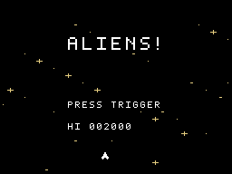
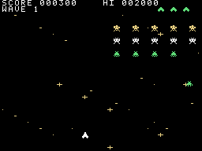
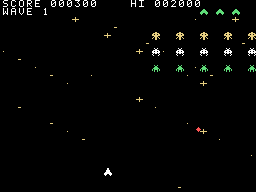

# Aliens! for the MSX

A **Galaga** clone for the MSX1 (Z80 + TMS9918A + AY-3-8910): a formation of
aliens sways and dives over a scrolling starfield, you shoot them down and
they shoot back.  Written in Z80 assembly, 16 KB cartridge, no banking, no
BIOS calls.




## What it does

* A **starfield** of 40 stars in three shapes, drifting down the screen one
  character cell at a time and wrapping round to the top.  The stars know
  which cells the game is using and never draw over the logo, the scoreboard
  or an alien.
* A **6 x 3 formation** of eighteen aliens, three kinds: bees at the bottom
  (50 points), the white row in the middle (100) and the bosses on top (150).
  The whole formation sways a column at a time, and drops a row towards you
  every four seconds or so.
* The aliens are **character cells**, not sprites, so the whole formation can
  be on screen at once - a TMS9918A only shows four sprites on any one
  scanline.  The two frames of each alien animate every 16 frames.
* **Divers**: every couple of seconds one of the aliens peels out of the
  formation and weaves its way down the screen as a sprite with its own
  colour.  If it reaches the bottom it climbs back into its slot; if it
  touches your ship you lose a life.  Two can be in the air at once.
* **The aliens shoot back**: a red spark leaves a random alien every second
  or so and falls towards you.
* Your ship slides along the bottom (3 pixels a frame), fires one bullet at a
  time (6 pixels a frame) and explodes into a sprite when something hits it.
  Three lives.
* **Waves**: clearing all eighteen earns 200 points and a fanfare, and the
  next wave sways faster, dives more often and shoots more often (capped, so
  wave 8 is still survivable).
* A scoreboard with `SCORE`, `HI` (kept for the session, seeded at 002000),
  `WAVE` and one little ship per life, plus a **GAME OVER** card that hands
  back to the title screen.
* Seven **AY-3-8910** sounds - shot, bang, the aliens' shot, a dive, the
  explosion when you die, the wave fanfare and the game over jingle - written
  as little scripts of register writes with a frame count per step (see
  below).





## Controls

| | |
|---|---|
| **Left / right** | cursor keys, or the joystick on port `$A8` |
| **Fire** | space, or the joystick trigger |
| **Title / game over** | fire starts a game; fire again from the game over card goes back to the title |

The joystick is on PPI port A (`$A8`, active low).  The keyboard is read too
- row 8 of the matrix, which is where the MSX puts the cursor keys (bits 7 to
4) and space (bit 0) - so the game plays with whatever you have plugged in,
and emulators that map the cursor keys to a joystick by default work either
way.

## Building

You need [sjasmplus](https://github.com/z00m128/sjasmplus):

```sh
git clone https://github.com/z00m128/sjasmplus
cd sjasmplus && make && sudo make install   # or just keep the binary around

cd msx/aliens            # from the repository root
make                     # -> aliens.rom (16 KB cartridge)
make SJASMPLUS=/path/to/sjasmplus
```

`make` also assembles `tools/bios.rom`, the sixteen kilobyte stub BIOS the
tests need, and regenerates `gfx.asm` if you touch `tools/gen_gfx.py`
(`make preview` renders the tiles and the title to `/tmp/aliens-*.png` so you
can look at the art without an emulator).

## Running

Any MSX1 emulator will do, for example:

* **openMSX** - `openmsx -cart aliens.rom`
* **blueMSX** (Windows) - *File > Run cartridge*, or drag the ROM onto it
* **WebMSX** (browser, `webmsx.com`) - *Load ROM*
* **fMSX** - `fmsx -cart aliens.rom`
* **Emulicious** - choose the MSX machine, then load the ROM

**If your emulator files it under the wrong console**, it is going by the
file extension: `.rom` is also the usual extension for Atari Jaguar dumps, and
Manic EMU on iOS, for one, puts `aliens.rom` under Jaguar because of it.
Nothing is wrong with the image - a 16 KB MSX1 cartridge whose first two bytes
are `AB` is exactly what is in the file - so copy it to **`aliens.mx1`**, the
MSX1 cartridge extension that no other system claims (`make mx1` does that),
and let it import again.  In Manic you can also long-press the game and use
*Assign Platform* to move it to MSX, then *Switch Core* to blueMSX (or fMSX).
BlueMSX wants MSX BIOS files for the full machines; its C-BIOS machine needs
none.

On real hardware: burn `aliens.rom` to a 16 KB EPROM cartridge.  The image
starts with the MSX cartridge header (`"AB"` at `$4000` and `INIT` at
`$4010`), so the BIOS starts it by itself; the game then takes the machine
over - interrupts off, its own VDP and PSG set up - and never calls back into
the BIOS.

## How it works

The interesting part is that an MSX1 has no bitmap mode worth using: the VDP
gives you 256 character patterns, one colour per group of eight patterns per
third of the screen, and 32 sprites of 8x8 (four per scanline).  So the game
is built out of characters:

| | |
|---|---|
| name table | `$1800` |
| pattern table (96 tiles) | `$0000` |
| colour table | `$2000` |
| sprite patterns | `$3800` |
| sprite attribute table | `$1B00` |
| PSG | `$A0` address / `$A1` data |
| RAM | `$C000` up (the machine has 16 KB there in this build) |

**Occupancy map.**  Because stars, aliens, explosions and the scoreboard all
write into the same name table, the game keeps a 32 x 24 byte map in RAM of
which cells belong to somebody.  Before drawing a star it asks; the formation
and the explosions claim their cells; the scoreboard claims its rows.  That
is what keeps the starfield from eating the logo.

**The sprite list is a list.**  On a TMS9918A a sprite whose y coordinate is
`$D0` *ends the sprite list* - the chip stops looking.  Parking a bullet
that is not in the air with `$D0` therefore hides everything after it in the
table, which is why the divers in this game first came out invisible: the
fix is to park unused sprites with `$D1` (off the bottom of the screen but
not the end marker) and keep only the real terminator at `$D0`.  The tests
check the sprite table, so the mistake cannot come back quietly.

**Sound.**  Each effect is a script of `(frames, count, register, value, ...)`
steps terminated by a zero.  The player is called once a frame, counts the
frames down and then applies the next step, so an effect is a table rather
than a pile of counters:

```
sfx_boom:
        db 3, 3, 7, 0x37, 6, 12, 8, 15   ; three frames, three writes:
        db 3, 2, 6, 18, 8, 11            ; noise on, noise pitch, volume
        db 4, 2, 6, 26, 8, 6
        db 2, 1, 8, 0
        db 0
```

The random numbers the divers, the shots and the stars need come from a
right-shifting 8 bit LFSR (period 255).  Two earlier attempts - a plain shift
register, then a multiply-by-five generator - scattered the *high* bits and
left the low ones marching in step, which is exactly the wrong way round for
code that only ever uses `and 0x1f`, and it made the stars line up in a
handful of columns.

## The tests

```sh
make check                     # 106 checks, and the screenshots above
make check PYTHON=/path/to/python3
```

`make check` needs Python 3 and [Pillow](https://python-pillow.org).  It runs
`aliens.rom` in `tools/msx.py`, a small MSX1 emulator written for this
repository (Z80, TMS9918A in Graphics I with sprites, AY-3-8910 register
model, PPI joystick port), started through `tools/bios.rom` the way the real
BIOS would start a cartridge.  It then reads the VDP's VRAM and the PSG's
registers back and plays the game with an autopilot:

* the cartridge header, the VDP registers and the tables, the 96 tile
  patterns and the eight sprite patterns, byte for byte against `gfx.asm`,
* the title screen: the big letters, `HI`, the blinking `PRESS TRIGGER`,
* the starfield: 20+ stars spread over the width, moving down, never in the
  scoreboard rows and never inside the letters,
* starting a game, the scoreboard, three lives, eighteen aliens in a 6 x 3
  grid in the right colours, the sway moving every tile with it,
* the ship and its walls, the bullet and its speed, the shot sound,
* killing a whole column: 50, then 100, then 150 points, the tiles going
  away, the explosion and the noise channel,
* a diver leaving the formation, coming down the screen and going home,
* an alien shot appearing, falling, and taking a life: the ship explodes,
  the life counter drops, the next ship is in the middle,
* losing the last ship, `GAME OVER`, the high score, and back to the title,
* clearing a wave: 200 points, `WAVE 2`, a fresh formation,
* 2400 frames of an autopilot playing hard: nothing written to the ROM, the
  state machine still sane, the scoreboard still there,
* every sound script in the ROM is well formed, and the shot fades to
  silence.

It also writes `screenshots/*.png` and `screenshots/gameplay.gif`.
