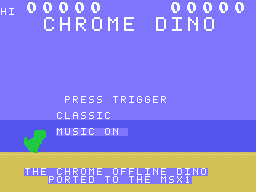
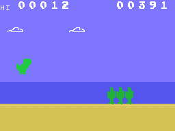
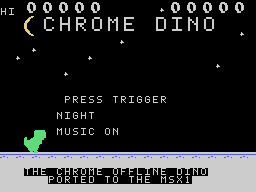
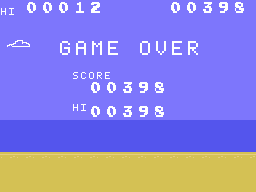

# CHROME DINO

The Chrome offline dinosaur, ported to the MSX1: a 16 KB Z80 cartridge for a
machine with a TMS9918A video chip and an AY-3-8910 sound chip, and a browser
build that runs the same ROM.

## Known issue: the pattern banks come first

Graphics II keeps three banks of 64 patterns, and **the VDP picks the bank
from which third of the screen the cell is in** - not from the name
(TMS9918A datasheet, 2.4.11: "names found in the upper third reference
pattern definitions found in the upper 2048 bytes...").  This ROM numbers its
192 patterns as one flat run - font, sky, ground, clouds, moon, stars, sand,
digits, logo - so only the top third of the screen is right: a real VDP reads
tile 45 in the middle third as pattern 109, which is a cloud.

`tools/msx.py` still models the flat numbering, which is why `make check`
passes and the screenshots in this folder show the intended picture.  The
browser build runs the same ROM on a real VDP core, so it shows what the chip
really does with it ([web-title.png](screenshots/web-title.png),
[web-play.png](screenshots/web-play.png)): the sprites are right - their
quadrants go into the table column by column, top left and bottom left first -
and the tile layer is not.

The fix is a re-layout, and it is the next thing to do:

* give each third its own copy of every tile it uses, numbered so the same
  local index (0-63) means the same picture in all three banks, and add
  `64 * (row >> 3)` to the name in the draw routines;
* a 44-pattern logo and a 43-glyph font will not fit in one 64-pattern bank,
  so the logo shrinks to two patterns a letter and each bank keeps only the
  glyphs that third actually draws;
* then flip `_render_g2` in `tools/msx.py` to the hardware rule, re-cut the
  screenshots and the checks come back honest.

## What it is

The dinosaur runs, the cactuses come, the pterodactyls fly over at three
heights, and the score clicks up ten at a time - the same game loop, the same
sprite sheet and the same three sounds as the page in `chrome://dino`.

It is not a redrawing of the game.  The sprites are cut out of Chromium's own
`100-offline-sprite.png`, and the numbers underneath - gravity 0.6, jump
velocity -10, speed from 6 to 13, a cactus every 120 to 270 pixels, the
pterodactyl only after 450 points, the blink and flash timings - are read out
of `components/neterror/resources/dino_game/` rather than guessed at.  The
mapping onto an MSX is written down in `tools/gen_gfx.py`.

On top of that, the things a 1979 console does differently:

* **colour** - the sheet is one bit per pixel, so the port paints it: a day
  palette, a dusk palette and a night one, each eight roles wide, and a
  rewrite of the VDP's colour table when the theme changes.  In the classic
  mode the sky turns over every four hundred points.
* **animations** - the dino runs at twelve frames a second and blinks, ducks
  with two frames of its own, flaps the bird with two, and the ground scrolls a
  pixel at a time by swapping name table entries - thirty two writes, no
  pattern uploads at all.
* **clouds** - the two clouds of the original, drifting slowly, drawn into the
  sky as tiles.
* **night** - a moon in six cells and eight stars, out in the night mode and on
  the title screen when the night mode is selected.
* **music** - a two voice tune from a four channel ProTracker module
  (`tools/dino.mod`), on the PSG's channels A and B.  Channel C is kept for
  the game's own sounds, so a jump never cuts the melody.
* **four modes** - Classic (the original speeds, birds after 800 points),
  Turbo (faster, birds earlier), Night (the dark sky) and Zen (slow, no birds,
  nothing to prove), each with its own high score.
* **the real sounds** - the jump, the point and the death sound, measured off
  Chromium's three mp3s and re-cut as AY-8910 register scripts
  (`sfx_jump`, `sfx_hit`, `sfx_point` in `dino.asm`).

## Controls

| key | joystick | what |
|---|---|---|
| space / trigger | button 1 | jump; on the title, start a game |
| down / up | down / up | duck when running |
| left / right | left / right | change the mode on the title screen |
| B | button 2 | music on and off |

## Build

    make                  # dino.rom, the 16 KB cartridge
    make check            # run it in the bundled emulator: 71 checks + screenshots
    make preview          # render the tiles and both title screens into /tmp
    make mx1              # the same image as dino.mx1
    make serve            # http://localhost:8000/web/ - the browser build
    make web-check        # the browser build's core, headless, under node (21 checks)

It needs `sjasmplus` on the PATH (or `make SJASMPLUS=/path/to/sjasmplus`),
and `python3` with Pillow for `make check` and `make preview`.  The ROM itself
only needs sjasmplus.

## How it is put together

* `dino.asm` - the game: boot, VDP and PSG setup, the sprite attribute table in
  RAM, the dino, the obstacles, collision, the modes, the scoreboard, the music
  driver and the three sounds.  Fixed at `$4000` with INIT at `$4010`, all the
  RAM in `$C000` and up, and no interrupts: it polls the VDP's frame flag.
* `gfx.asm` - generated by `tools/gen_gfx.py` from `tools/chrome-sprite.png`:
  the 192 patterns (a 96 character font cut from the sheet, two sky tiles,
  thirty two ground phases, two clouds in eight phases each, the moon, the
  stars, sand, the big digits, the logo), the 36 sprite patterns, and the
  tables that say which colour role each pattern uses.
* `music.asm` - generated by `tools/mod2msx.py` from `tools/dino.mod`.
* `tools/msx.py` - a small MSX1 (Z80, TMS9918A in Graphics II, AY-3-8910, PPI)
  with a renderer and an AY register model, enough to run the cartridge and
  look at it.
* `tools/capture.py` - the test suite: it boots the ROM through a stand-in
  BIOS, checks the art, the title screen, the modes, the music, the score, a
  jump, a duck, a death and the end card, and writes the screenshots.
* `web/` - the browser build: blueMSX compiled to WebAssembly (from
  `libretro/bluemsx`), driven by `web/emulator.js`.  It is the honest one of
  the two: see *Known issue* below for why its tile layer looks wrong.

## Layout of the screen

Graphics II gives every one of the 768 cells its own pattern and its own
colour, which is what makes a real sky, a real moon and a real sprite sheet
possible on a TMS9918A.  The tiles are:

| tiles | what |
|---|---|
| 0-42 | the font, ASCII 32 upwards |
| 43-44 | the sky, and the deeper band under the horizon |
| 45-76 | the ground, sixteen phases in two rows |
| 77-84 | two clouds, four cells each |
| 85-90 | the moon |
| 91-92 | the stars |
| 93 | sand |
| 94-101 | "HI" in the sheet's own little letters |
| 102-141 | the digits, four cells each |
| 142-185 | CHROME DINO, four cells a letter |

## Licence

The art is Chromium's (`tools/chrome-sprite.png`, BSD, see
`LICENSE-chromium`), the three sounds are measured from Chromium's mp3s in
`components/neterror/resources/sounds/`, and the music is this repository's
own module (`tools/dino.mod`).  Everything else is here.
