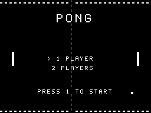
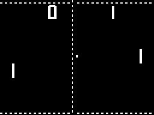
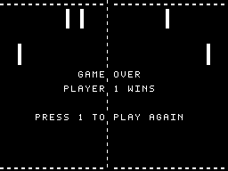

# Pong for the Sega SG-1000

A close reconstruction of Atari's 1972 arcade **Pong** for the SG-1000
(Z80 + TMS9918A + SN76489).  Written in Z80 assembly, 16 KB cartridge, no
banking, no BIOS.





## What it does

* 256x192 black & white court with the dashed top/bottom rails and the
  dashed centre net of the original.
* 4x24 paddles and a 4x4 square ball, exactly the arcade proportions.
* The ball leaves the paddle at an angle that depends on *where* it hit:
  six zones per paddle, from -3 to +3 vertical pixels per frame.
* The ball gets faster with every paddle hit (2 -> 4 pixels per frame
  horizontally) and bounces off the top and bottom rails.
* After a point the ball is served from the centre towards the player who
  lost the point, after a short pause - just like the arcade.
* Chunky 7-segment score digits, two digits per side (the tens digit only
  appears from 10 onwards), first player to **11** wins.
* Square-wave blips on the SN76489: ~491 Hz when the ball hits a paddle,
  ~226 Hz off a wall, ~113 Hz when a point is scored.
* One or two players.  In one player mode a simple CPU plays the right
  paddle: it waits near the centre until the ball crosses the half way
  line, then follows it at 2 px/frame with a small dead zone, so steep
  shots beat it.
* The console's HOLD button - labelled **HOLD** on the SG-1000, PAUSE on the
  SG-1000 II - freezes the game; the ball blinks so the freeze is obvious.
  Joypad 1 **button 2** taps the same switch, for emulators whose on-screen
  overlay does not give you the console button.



## Controls

| | |
|---|---|
| **Player 1** | joypad 1 **up**/**down** moves the left paddle |
| **Player 2** | joypad 2 **up**/**down** moves the right paddle |
| **Menu** | up/down selects 1 or 2 players, **button 1** starts |
| **Game over** | **button 1** goes back to the title screen |
| **HOLD** | the console button (labelled PAUSE on the SG-1000 II) freezes / unfreezes the game |
| **Pause** | joypad 1 **button 2** taps the same switch |

The two-player mode needs both joypads plugged in.  Up/down for player 2 is
read from port `$DC` bits 6-7, which is how the SG-1000 wires the second
controller (its left/right/buttons are on `$DD`).

## Building

You need [sjasmplus](https://github.com/z00m128/sjasmplus):

```sh
git clone https://github.com/z00m128/sjasmplus
cd sjasmplus && make && sudo make install   # or just keep the binary around

cd pong
make                     # -> pong.sg  (16 KB)
make SJASMPLUS=/path/to/sjasmplus
```

`make` also regenerates `gfx.asm` if you touch `tools/gen_gfx.py`.

## Running

Any SG-1000 capable emulator will do, for example:

* **Emulicious** (Windows/macOS/Linux, has a great SG-1000 mode)
* **MEKA** (Windows)
* **Genesis Plus GX** (RetroArch core `genesis_plus_gx`) - load `pong.sg`
  and it switches to SG-1000 hardware
* **SMS Plus GX**, **BlueMSX**, **MAME** (`mame sg1000 -cart pong.sg`)
* **Manic Emu** (iOS, Gearsystem core) - pick the SG-1000 system for the ROM

On real hardware: burn `pong.sg` to a 16 KB (or larger, e.g. 27C256)
EPROM cartridge; the image starts at `$0000` and needs no header.

## How it is put together

| area | |
|---|---|
| VDP mode | Graphics I (R0 `$00`, R1 `$A0` while the tables are loaded, then R1 `$E0`) |
| pattern table | `$0000` (R4 `$00`) - 143 tiles: blank, rail, net, 5x7 text font, 7-segment digits, `PONG` |
| colour table | `$2000` (R3 `$80`) - 32 bytes of `$F1`, so every tile is white on black |
| name table | `$1800` (R2 `$06`) |
| sprite attributes | `$1B00` (R5 `$36`) - 7 sprites: 3 per paddle, 1 for the ball |
| sprite patterns | `$3800` (R6 `$07`) - 4x8 paddle bar, 4x4 ball |
| RAM | `$C000-$C3EF` (the SG-1000 only has 1 KB; the stack lives at `$C3F0`) |
| frame sync | the VDP status read flag (bit 7) is polled; IRQs stay masked |
| sound | SN76489 channel 0 only |

The game logic is one pass per video frame (60 Hz):

```
wait for vblank -> read pads -> move paddles -> move ball / collisions
                -> update 7 sprites -> service the sound timer
```

Paddle movement is 3 px/frame for humans, 2 px/frame for the CPU.  The
ball's horizontal speed starts at 2 and grows by one on every paddle hit up
to 4; its vertical speed is picked from the hit zone when it leaves a
paddle, so the rally gets faster and steeper the longer it lasts.

### Files

```
pong.asm            the game (hardware init, screens, logic, sound)
gfx.asm             generated tile patterns + the two name tables
pong.sg             built cartridge image (16 KB)
tools/gen_gfx.py    the artwork: 5x7 font, 7-segment digits, court layout
tools/sg1000.py     tiny SG-1000 emulator (Z80 + TMS9918A + SN76489)
tools/capture.py    runs the ROM headless: 18 checks + screenshots/gif
tools/gsrun.cpp     cross-check harness: runs the ROM on the Gearsystem core
screenshots/        what the emulator captured
```

## Development notes

The artwork is generated, so the tiles and the layout can be edited without
touching assembly:

```sh
python3 tools/gen_gfx.py --preview    # also dumps PNG previews to /tmp
```

`tools/capture.py` boots the ROM in the bundled emulator, plays a real rally
with two "players" on autopilot and asserts what happened:

```
$ make check
boot
  ok   boots to the title screen
pause
  ok   button 2 pauses
  ok   the ball is frozen
  ok   button 2 resumes
  ok   the ball moves again
two player match
  ok   button 1 starts a match
  ok   menu selects two players
  ...
  ok   paddle hit blip at 491 Hz
  ok   wall bounce blip at 226 Hz
  ok   points are scored and served again (1)
  ok   eleven points end the match
  ok   game over screen is shown
  ok   button 1 returns to the title screen
  ok   no stray writes to the cartridge ROM
  ok   only known I/O ports are touched

18 checks, 0 failed
```

It needs `pip install z80 pillow`.  The emulator is deliberately fussy: it
only has 1 KB of mirrored RAM, it reports writes into the cartridge ROM, and
it logs any I/O port the game should not be touching.  It also counts the
real 59736 T-states per frame and raises the vblank flag after the 192
visible lines, so the game samples the joypads on the same frame there as it
does on hardware - which is what makes the lockstep comparison below work.

### VDP table registers (the one thing that is easy to get wrong)

`tools/sg1000.py` decodes R2-R6 the way the TMS9918A datasheet (and real
hardware, and Gearsystem/MEKA/MAME) does:

| register | holds | unit | value here |
|---|---|---|---|
| R2 | name table | `$400` | `$06` -> `$1800` |
| **R3** | **colour table** | `$40` | `$80` -> `$2000` |
| **R4** | **pattern generator table** | `$800` | `$00` -> `$0000` |
| R5 | sprite attribute table | `$80` | `$36` -> `$1B00` |
| R6 | sprite pattern generator table | `$800` | `$07` -> `$3800` |

R3 is *not* the pattern table: a first version of this ROM had the two
swapped (the layout some Master System code uses, since the SMS VDP puts the
pattern table at `$0000` via R4 and the sprite patterns elsewhere).  On real
hardware - and on Manic Emu's Gearsystem core - that reads the name table
tiles out of the colour table, so the field comes out as a handful of
multicoloured junk tiles.

A second SG-1000 quirk: the console powers up with R1 = `$00`, which on a
real machine means VRAM is addressed in its 4K layout.  Writing R1 bit 7
switches to 16K and *remaps* the bytes already in VRAM (Gearsystem models
this faithfully), so `vdp_init` programs all eight registers first and only
then clears the 16 KB and uploads the tables.  The display stays blanked
(R1 `$A0`) until everything is in place.

The ROM was cross-checked against the Gearsystem core - the one Manic Emu
ships - by running both emulators in lockstep and diffing the VRAM and the
rendered frames: boot, title, a two player rally, a full 11 point match and
the game over screen come out byte-for-byte and pixel-for-pixel identical
(so the screenshots in this README are exactly what the core draws).

`tools/gsrun.cpp` is the little harness used for that; it builds straight
against a [Gearsystem](https://github.com/drhelius/Gearsystem) checkout:

```sh
GS=/path/to/Gearsystem
g++ -std=c++14 -O2 -w -I$GS/src -I$GS/platforms/shared/dependencies/miniz \
    $GS/src/*.cpp $GS/src/audio/*.cpp $GS/src/audio/emu2413/emu2413.c \
    $GS/platforms/shared/dependencies/miniz/miniz.c tools/gsrun.cpp -o gsrun

./gsrun pong.sg out.ppm 240 ""                # title screen, 240 frames
./gsrun pong.sg out.ppm 1200 "$(python3 -c "print('n'*20+'b'*20+'n'*1200)")" vram.bin
```

The script is one character per frame: `b` button 1, `u`/`d` pad 1 up/down,
`U`/`D` pad 2 up/down, `p` the console HOLD button (it sends the NMI), `q`
pad 1 button 2, `n` nothing.

It forces the SG-1000 system (no auto-detection), so it renders exactly what
an SG-1000 cartridge sees, and with `-fsanitize=address` it also catches VDP
table registers that point outside the 16 KB of VRAM.  Both pause routes
were checked there as well: `p` freezes the ball (and blinks it) and `q`
does the same, so the game pauses from the console button and from the
joypad.

### Differences from the arcade cabinet

* The arcade used rotary paddle controllers; the SG-1000 joypad moves the
  paddle up and down at a fixed speed instead.
* The arcade's attract mode is replaced by a title screen with a 1P/2P
  choice (the field is still there, and the ball bounces around behind it).
* The arcade had no pause button or CPU opponent; both are here.
