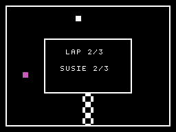

# DELTARUNE Chapter 3 Hidden Racing Minigame

The racing game that is hidden inside **Deltarune Chapter 3**, rebuilt as a
real, playable SG-1000 cartridge image (Z80 + TMS9918A + SN76489).  You are a
white square on a black track with a white outline, there is a white outline
square in the middle, and you race Susie around it three times.




## Why it is called that

In Chapter 3, in the Green Room of the TV studio, the left television has a
racing game on it and Susie challenges Kris to a race.  The camera is placed
behind Kris, so you never see the screen - you only see their hands working
the controller.  What makes it special is that the game **really is running**:
The Cutting Room Floor documents that it is a playable simulation behind the
camera, revealed by a script variable called `_debug_visible`, and it can be
played without any debug mode at all.

The minigame itself:

* a box on a square track which you steer with the movement keys; the whole
  game is *driving the box around the square*, clockwise,
* Kris' hands keep bobbing while you are making progress and stop dead with a
  bump sound effect when you hit a wall,
* you get **three attempts** - the attempt count lives in save flag `1034`,
  the win in flag `1035`, and once you have burned all three Susie refuses to
  play again,
* if you win, Ralsei congratulates Kris and **Susie sulks**.

The route the community settled on is *hold left until the bump, then up,
then right, then down* - one clockwise lap of the square that starts on the
bottom edge, right of the finish line.  This cartridge uses exactly that
layout, and shows you the scoreboard the real one hides behind Kris' back.

Sources: [TCRF - Deltarune Chapter 3, "Racing Game Visuals"](https://tcrf.net/Deltarune/Chapter_3),
[Deltarune Wiki - Green Room](https://deltarune.wiki/w/Green_Room),
[Steam guide with the winning input sequence](https://steamcommunity.com/sharedfiles/filedetails/?id=3562945951).

## What it does

* A 256x192 track: a 2 pixel white wall around the outside and a 2 pixel
  white square in the middle, everything else black, with a two column
  **chequered finish line** running from the bottom of the middle square to
  the bottom wall.
* Your square starts on the **right of the finish line** in the bottom
  straight and drives clockwise.  It moves 2 pixels a frame in whichever of
  the four directions you hold, and walls (outer and middle) stop it dead
  with a bump - the same bump the real minigame plays when Kris' hands stop.
* **Susie** races you.  She is the magenta square, takes the outside lane at
  half your speed, drives the same clockwise lap and counts her laps at the
  same line.  Beat her over three laps and she sulks: the screen shows
  `YOU WIN`.  If she gets her three laps first, Kris loses and the screen
  shows `SUSIE WINS`.
* A lap only counts when it *is* a lap: the square has to pass a checkpoint
  in each of the other three straights before the finish line scores, so you
  cannot win by wiggling over the line.
* The middle square is the scoreboard - `LAP 1/3` and `SUSIE 1/3` are drawn
  inside it.  Same view as the hidden screen in the real game, just visible.
* Square wave blips on the SN76489: a wall bump, a lap, the win and the loss.
* The console's HOLD button - labelled **HOLD** on the SG-1000, PAUSE on the
  SG-1000 II - freezes the game.  Joypad 1 **button 2** taps the same switch
  for emulators whose overlay does not give you the console button.


## Controls

| | |
|---|---|
| **Race** | joypad 1 **up**/**down**/**left**/**right** drives the square |
| **Title** | **button 1** starts a race |
| **End screen** | **button 1** goes back to the title screen |
| **HOLD** | the console button (PAUSE on the SG-1000 II) freezes / unfreezes |
| **Pause** | joypad 1 **button 2** taps the same switch |

The HOLD button is an NMI on the Z80 (it vectors through `$0066`), which is
why the game can freeze at any moment, even mid-frame.  The pause toggle is
armed in both the NMI handler and on the button 2 edge in software, and both
lead to the same latch at `$C003`.

## Building

You need [sjasmplus](https://github.com/z00m128/sjasmplus):

```sh
git clone https://github.com/z00m128/sjasmplus
cd sjasmplus && make && sudo make install   # or just keep the binary around

cd sg1000/deltarune-race    # from the repository root
make                        # -> deltarune.sg  (16 KB)
make SJASMPLUS=/path/to/sjasmplus
```

`make` also regenerates `gfx.asm` if you touch `tools/gen_gfx.py`.

## Running

Any SG-1000 capable emulator will do, for example:

* **Manic Emu** (iOS, Gearsystem core) - pick the SG-1000 system for the ROM
* **Emulicious** (Windows/macOS/Linux, has a great SG-1000 mode)
* **MEKA** (Windows)
* **Genesis Plus GX** (RetroArch core `genesis_plus_gx`) - load
  `deltarune.sg` and it switches to SG-1000 hardware
* **SMS Plus GX**, **BlueMSX**, **MAME** (`mame sg1000 -cart deltarune.sg`)

On real hardware: burn `deltarune.sg` to a 16 KB (or larger, e.g. 27C256)
EPROM cartridge; the image starts at `$0000` and needs no header.  The D-pad
is joypad 1, whose directions are on port `$DC` bits 0-3 (active low).

## How it is put together

| area | | |
|---|---|---|
| VDP mode | Graphics I (R0 `$00`, R1 `$A0` while the tables are loaded, then R1 `$E0`) |
| pattern table | `$0000` (R4 `$00`) - 77 tiles: blank, wall pieces, chequers, 5x7 text font |
| colour table | `$2000` (R3 `$80`) - 32 bytes of `$F1`, every tile white on black |
| name table | `$1800` (R2 `$06`) - 32x24 cells, the whole track is redrawn per screen |
| sprite attributes | `$1B00` (R5 `$36`) - 2 sprites, two rows of 4 bytes |
| sprite patterns | `$3800` (R6 `$07`) - one solid 8x8 block, the SAT colours it |
| RAM | `$C000-$C3EF` (the SG-1000 only has 1 KB; the stack lives at `$C3F0`) |
| frame sync | the VDP status read flag (bit 7) is polled; IRQs stay masked |
| sound | SN76489 channel 0 only |

The game logic is one pass per video frame (60 Hz):

```
wait for vblank -> read pads -> service pause -> move the square (walls!)
                -> lap checkpoints -> move Susie -> update the 2 sprites
```

Both cars are 8x8 squares built from a single all-`$FF` sprite pattern; the
player's sprite attribute is `$0F` (white), Susie's is `$0D` (light magenta).
The tile map is generated, so the walls, the middle square and the chequered
line are just tiles 1-12 placed by `tools/gen_gfx.py`:

| | |
|---|---|
| outer wall | cells 1..30 across, 1..22 down (pixels x 8..247, y 8..183) |
| middle square | cells 8..23 across, 7..16 down (pixels x 64..191, y 56..135) |
| finish line | cells 15 and 16, from row 17 to the bottom wall (x 120..135) |
| lane width | 46 px above and below the middle square, 54 px to its left and right |
| car start | (140, 155) - right of the line, middle of the bottom straight |
| Susie start | (100, 155) - past the line, so she cannot count a lap at once |

Collision is a plain rectangle test against `x 57..191` / `y 49..135` (the
middle square grown by the car's 7 pixel extent) plus the outer limits
`x 10..238`, `y 10..174`.  Movement is 2 px/frame, so a corner bump can
never tunnel: the step is shorter than the wall.

### Files

```
deltarune.asm       the game (hardware init, screens, lap logic, sound)
gfx.asm             generated tile patterns, the track map and the title text
deltarune.sg        built cartridge image (16 KB)
tools/gen_gfx.py    the artwork: wall/chequer tiles, 5x7 font, track layout
tools/sg1000.py     tiny SG-1000 emulator (Z80 + TMS9918A + SN76489)
tools/capture.py    runs the ROM headless: 40 checks + screenshots/gif
tools/crosscheck.py the same ROM on the real Gearsystem core, byte for byte
tools/gsrun.cpp     cross-check harness: wraps the Gearsystem core
screenshots/        what the emulator captured
```

## Development notes

The artwork is generated, so the tiles and the layout can be edited without
touching assembly:

```sh
python3 tools/gen_gfx.py --preview    # also dumps PNG previews to /tmp
```

`tools/capture.py` boots the ROM in the bundled emulator, plays real laps on
autopilot and asserts what happened - 40 checks, including the exact title
text in the name table, the wall and middle square tiles, the chequers, the
sprite positions and colours, three laps to win, Susie winning if you idle,
the lap checkpoints refusing to score a wiggle over the line, and both pause
buttons:

```
$ make check
...
40 checks, 0 failed
screenshots in screenshots
```

### Cross-checking against Gearsystem

Our own emulator is convenient but it is not the thing the ROM has to run on.
`tools/gsrun.cpp` wraps the **real Gearsystem core** (the one Manic Emu and
most RetroArch users run) in a headless runner and dumps both a PPM frame and
the 16 KB of VRAM:

```sh
GS=../gearsystem   # a Gearsystem checkout
g++ -std=c++14 -O2 -w -I$GS/src -I$GS/platforms/shared/dependencies/miniz \
    $GS/src/*.cpp $GS/src/audio/*.cpp $GS/src/audio/emu2413/emu2413.c \
    $GS/platforms/shared/dependencies/miniz/miniz.c tools/gsrun.cpp -o gsrun

python3 tools/crosscheck.py ./gsrun     # or: make crosscheck EMU=./gsrun
```

`crosscheck.py` feeds the identical pad script to both emulators and compares
the frame and **all of VRAM** byte for byte, then presses console HOLD
(`Key_Start` on the harness, which is the NMI button) and button 2 to prove
that the pause works on the real core.  It is the kind of check that caught
the swapped VDP colour-table register while Pong was being written, so it is
worth running before believing anything:

```
the real core draws what our emulator draws
  ok   every pixel of the frame is identical (147456 bytes)
  ok   all 16 KB of VRAM are identical
  ok   the car's sprite is where the game put it [136, 60, 0, 15]
  ok   a race is running (1)
pause on the real core
  ok   without a pause the car drives on (x=60)
  ok   HOLD freezes it mid-straight (x=100)
  ok   joypad button 2 freezes it as well (x=100)
```

### What is different from the real minigame

The real one runs behind Kris' back on a TV screen you never see, and its
only feedback is the bump and whether the hands keep moving.  This version
shows the track, adds a visible scoreboard, and gives you an opponent in the
outside lane so that "three attempts" becomes "three laps against Susie":
beating her is the win, losing is the sulk.  Susie drives the outside lane
on rails; she is not a simulation of the real scripted race, which - like the
hidden original - you win by simply completing the laps.
